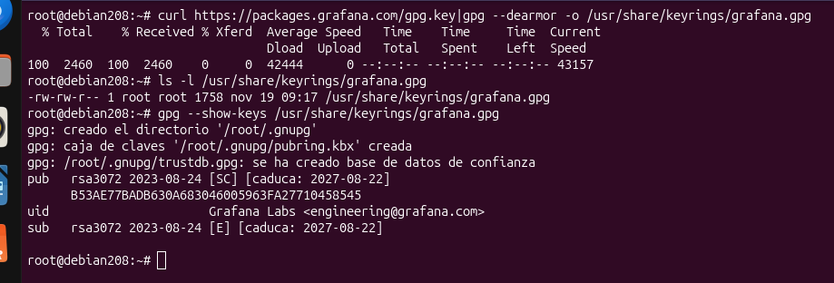
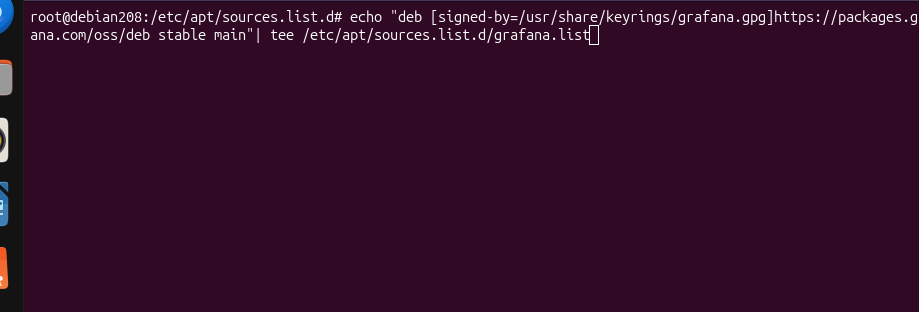
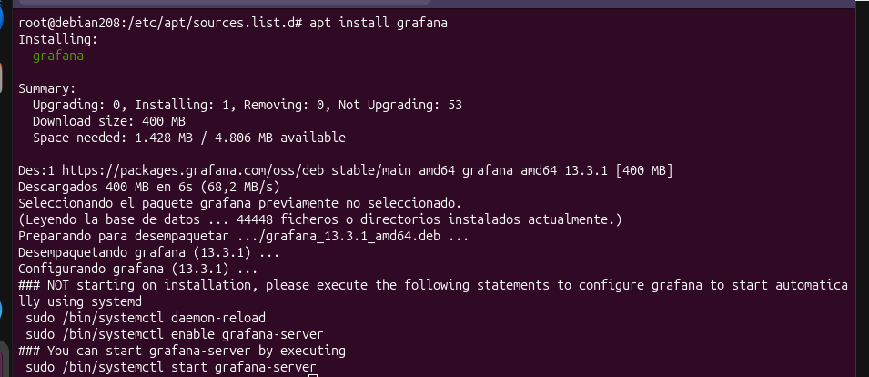
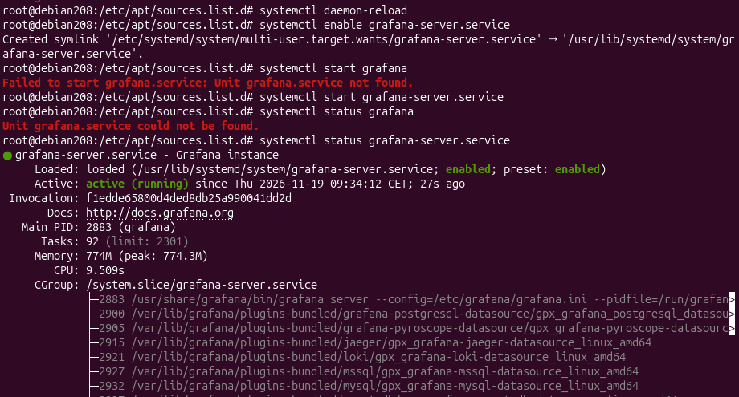
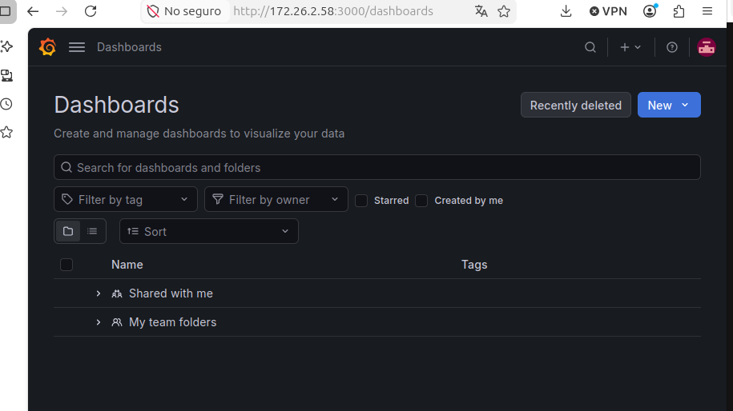

# Instalación de Grafana en Debian

## 1. Instalación de dependencias

En primer lugar, instalamos los paquetes necesarios para poder descargar Grafana y configurar su repositorio oficial.

Ejecutamos el siguiente comando:

```bash
apt install curl gpg apt-transport-https
```

- `curl`: permite descargar archivos desde Internet.
- `gpg`: permite gestionar y verificar claves GPG.
- `apt-transport-https`: permite utilizar repositorios mediante HTTPS.


## 2. Descargar la clave GPG de Grafana

A continuación, descargamos la clave GPG oficial de Grafana y la guardamos en el directorio de claves de confianza del sistema.

Ejecutamos:

```bash
curl https://packages.grafana.com/gpg.key | gpg --dearmor -o /usr/share/keyrings/grafana.gpg
```

Para comprobar que la clave se ha descargado correctamente, utilizamos:

```bash
ls -l /usr/share/keyrings/grafana.gpg
gpg --show-keys /usr/share/keyrings/grafana.gpg
```

De esta forma, verificamos que la clave pertenece a Grafana Labs.



## 3. Añadir el repositorio de Grafana

Una vez descargada la clave, añadimos el repositorio oficial de Grafana a la lista de repositorios de Debian.

Ejecutamos:

```bash
echo "deb [signed-by=/usr/share/keyrings/grafana.gpg] https://packages.grafana.com/oss/deb stable main" | tee /etc/apt/sources.list.d/grafana.list
```

Esto permite que el sistema pueda obtener Grafana directamente desde su repositorio oficial.



## 4. Instalar Grafana

Con el repositorio configurado, actualizamos la lista de paquetes e instalamos Grafana.

Primero:

```bash
apt update
```

Después:

```bash
apt install grafana
```

El sistema descargará e instalará el paquete de Grafana y realizará su configuración.



## 5. Iniciar y habilitar el servicio

Una vez instalado Grafana, debemos configurar su servicio para que se inicie automáticamente al arrancar el sistema.

Primero, recargamos la configuración de systemd:

```bash
systemctl daemon-reload
```

Habilitamos el servicio:

```bash
systemctl enable grafana-server.service
```

Iniciamos Grafana:

```bash
systemctl start grafana-server.service
```

Finalmente, comprobamos su estado:

```bash
systemctl status grafana-server.service
```

Si todo ha funcionado correctamente, aparecerá el estado **Active: active (running)**, indicando que Grafana está funcionando.

**Nota:** El nombre correcto del servicio es `grafana-server`, no `grafana`.



## 6. Acceder a Grafana desde el navegador

Una vez iniciado el servicio, podemos acceder a Grafana desde un navegador web utilizando la dirección IP del servidor y el puerto 3000.

La dirección tiene el siguiente formato:

```text
http://IP_DEL_SERVIDOR:3000
```

En nuestro caso, accedemos mediante:

```text
http://172.26.2.58:3000
```

Al acceder, podemos visualizar la interfaz web de Grafana, desde donde podremos crear y administrar nuestros dashboards.



## Conclusión

Con estos pasos hemos conseguido instalar Grafana en Debian, configurar su repositorio oficial, iniciar el servicio y acceder correctamente a su interfaz web.

Grafana ya está preparado para crear dashboards y visualizar métricas mediante diferentes fuentes de datos.
