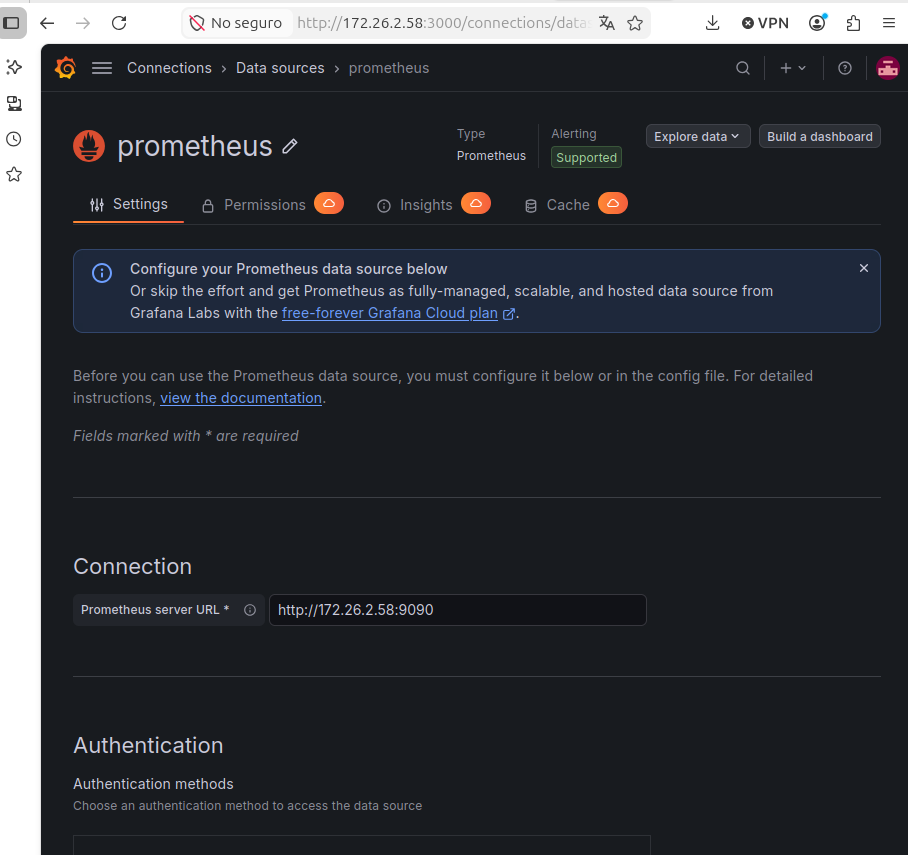
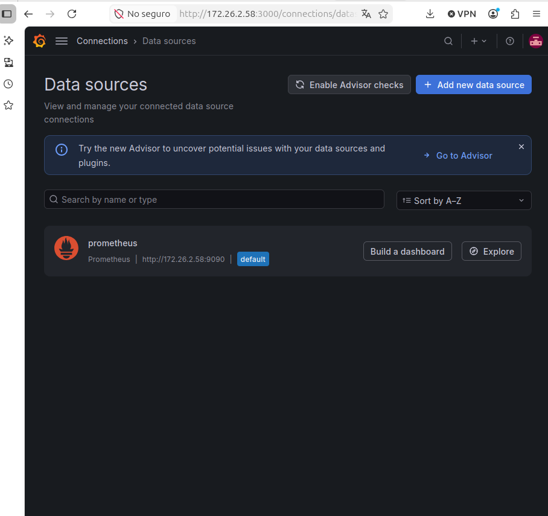
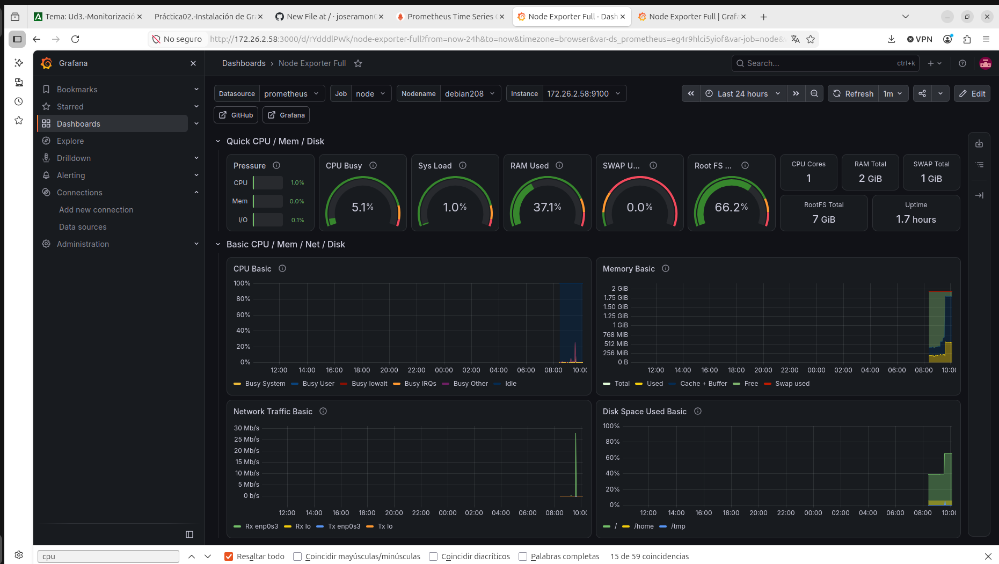

# Añadir Prometheus como Data Source en Grafana

## 1. Configurar Prometheus como fuente de datos

Una vez dentro de Grafana, accedemos al apartado **Connections → Data sources** y seleccionamos Prometheus para configurar una nueva fuente de datos.

En el apartado de configuración, introducimos la dirección del servidor Prometheus en el campo **Prometheus server URL**.

En nuestro caso, utilizamos la siguiente dirección:

```text
http://172.26.2.58:9090
```

Esta dirección permite que Grafana se conecte con el servidor Prometheus, desde donde obtendrá las métricas necesarias para mostrarlas posteriormente en los dashboards.



## 2. Comprobar que Prometheus está añadido correctamente

Después de configurar y guardar la conexión, volvemos al apartado **Connections → Data sources**.

En esta sección podemos comprobar que Prometheus aparece en la lista de fuentes de datos configuradas.

También podemos observar que aparece marcado como **default**, lo que significa que es la fuente de datos predeterminada de Grafana.



## 3. Visualización de métricas mediante un dashboard

Una vez configurado Prometheus, podemos utilizar sus datos para crear dashboards y visualizar las métricas del servidor.

En este caso, utilizamos el dashboard **Node Exporter Full**, que permite consultar diferentes métricas del sistema.

Entre las métricas que podemos visualizar se encuentran:

- **CPU:** porcentaje de uso del procesador.
- **RAM:** memoria utilizada y disponible.
- **SWAP:** memoria de intercambio utilizada.
- **Disco:** espacio utilizado en el sistema de archivos.
- **Red:** tráfico de entrada y salida de la red.
- **Uptime:** tiempo que lleva funcionando el servidor.

En el dashboard también podemos observar que la fuente de datos seleccionada es `prometheus` y que se están recogiendo métricas del servidor `debian208`.

Esto permite comprobar que Grafana está obteniendo correctamente los datos proporcionados por Prometheus.



## Conclusión

Con estos pasos hemos conseguido añadir Prometheus como fuente de datos en Grafana y comprobar que la conexión funciona correctamente.

Finalmente, hemos utilizado el dashboard Node Exporter Full para visualizar diferentes métricas del servidor Debian, como el uso de CPU, memoria RAM, disco y tráfico de red.

De esta manera, Grafana puede utilizar los datos recopilados por Prometheus para representar gráficamente el estado y rendimiento del servidor.
